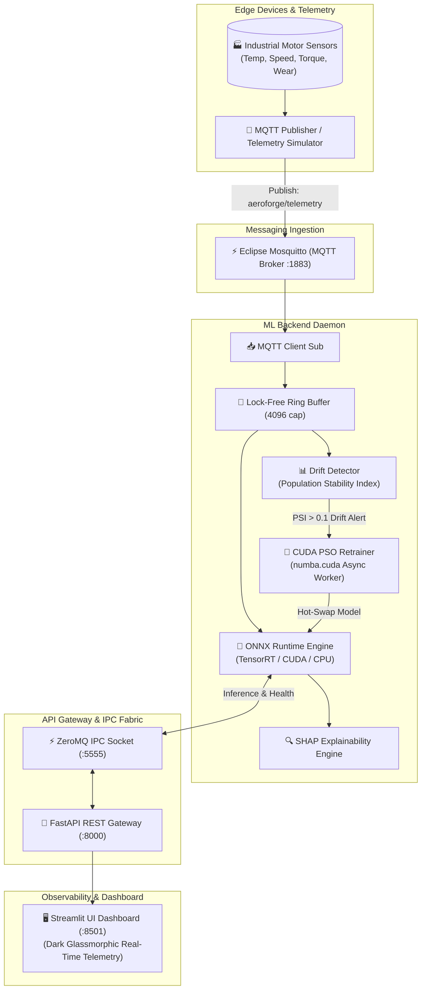

# AeroForge — Autonomous Predictive Edge AI Platform

[](https://github.com/Ravva-78/motor-health-pso-cuda/actions/workflows/ci.yml)
[](tests/)
[](requirements.txt)
[](backend/cuda_module.py)
[](backend/api_server.py)
[](app.py)
[](LICENSE)

**AeroForge** is an enterprise-grade IoT predictive maintenance platform engineered for high-frequency industrial motor environments. It continuously ingests live sensor telemetry over MQTT, executes sub-millisecond AI inference via hardware-accelerated ONNX Runtime, generates real-time SHAP explainability insights, and features an autonomous self-healing pipeline that detects data drift (PSI) and triggers background Particle Swarm Optimization (PSO) GPU retraining without dropping a single inference request.

---

## 📖 Table of Contents
- [Architecture Highlights](#-architecture-highlights)
- [System Architecture Diagram](#-system-architecture-diagram)
- [Key Features](#-key-features)
- [Tech Stack](#-tech-stack)
- [Performance & Hardware Fallback](#-performance--hardware-fallback)
- [Repository Structure](#-repository-structure)
- [Installation & Quick Start](#-installation--quick-start)
- [Running the Test Suite](#-running-the-test-suite)
- [Docker Deployment](#-docker-deployment)
- [Engineering Documentation](#-engineering-documentation)
- [License & Contributors](#-license--contributors)

---

## 🏗 Architecture Highlights

- **Decoupled Microservices**: Networking, telemetry ingestion, and ML execution are isolated from REST gateways to eliminate blocking overhead.
- **Lock-Free Ring Buffer**: Thread-safe circular buffer (`RingBuffer`, capacity 4096) absorbs bursty MQTT sensor telemetry.
- **ZeroMQ IPC Fabric**: Low-latency ZeroMQ REQ/REP socket (`tcp://127.0.0.1:5555`) bridges the FastAPI REST gateway and the background ML Daemon.
- **Accelerated Inference Engine**: Production ONNX model with seamless priority escalation: `TensorRT` → `CUDA` → `CPUExecutionProvider`.
- **Explainable AI (XAI)**: Integrated `SHAP TreeExplainer` identifies top anomalous features (temperature, torque, vibration/speed, tool wear) per inference.
- **Autonomous Retraining (PSO)**: Continuous Population Stability Index (PSI) drift monitoring automatically triggers background GPU-accelerated hyperparameter search via `numba.cuda` and hot-swaps the model with zero downtime.

---

## 📐 System Architecture Diagram



---

## ✨ Key Features

1. **Sub-Millisecond Inference**: Hardware-optimized ONNX model evaluation designed for real-time edge processing.
2. **Autonomous Drift Self-Healing**: Real-time statistical monitoring computes feature-level Population Stability Index (PSI). When drift is detected, background PSO optimizes hyperparameter spaces without interrupting production.
3. **Atomic Model Hot-Swapping**: Safely swaps inference pointers to new ONNX models without dropping incoming client requests.
4. **Real-time Explainable AI (XAI)**: Generates ranked feature attributions via SHAP so engineers know exactly *which* metric drove a fault prediction.
5. **Decoupled Asynchronous IPC**: ZeroMQ transport prevents high-load ML retraining from affecting external REST API responsiveness.
6. **Robust Fault Tolerance**: Auto-reconnects on MQTT packet drops, handles ring buffer saturation gracefully, and provides automated CPU fallback if GPU runtimes are unavailable.

---

## 🛠 Tech Stack

| Domain | Technologies |
| :--- | :--- |
| **Edge & Messaging** | Eclipse Mosquitto, Paho-MQTT, Custom Lock-Free Ring Buffer |
| **Inference & Acceleration** | ONNX Runtime, NVIDIA TensorRT, CUDA 12.x, `numba.cuda` |
| **Machine Learning & XAI** | Scikit-Learn, Particle Swarm Optimization (PSO), SHAP |
| **Backend & IPC** | Python 3.11, ZeroMQ (`pyzmq`), FastAPI, Uvicorn |
| **Frontend & Visualization**| Streamlit, Plotly, Dark Glassmorphism CSS |
| **DevOps & Testing** | Docker, Docker Compose, Pytest (55 Unit/Integration tests), GitHub Actions CI |

---

## 🚀 Performance & Hardware Fallback

### Graceful CPU Fallback (ONNX ML Inference)
To maximize compatibility across bare-metal environments and CI pipelines, the ONNX Inference engine checks for native NVIDIA `cuDNN` and `TensorRT` libraries. **If these C++ binaries are missing from the host, the daemon executes a seamless fallback to `CPUExecutionProvider`.** The application maintains full operational continuity.

### CUDA Acceleration (PSO Retraining)
The Particle Swarm Optimization (PSO) hyperparameter search leverages `numba.cuda` to evaluate candidate populations across GPU warps in parallel, dramatically reducing convergence time during continuous retraining cycles.

---

## 📂 Repository Structure

```text
motor-health-pso-cuda/
├── .github/workflows/ci.yml # GitHub Actions Continuous Integration pipeline
├── app.py                   # Streamlit live telemetry & glassmorphic dashboard
├── backend/                 # Core platform microservices
│   ├── api_server.py        # FastAPI REST gateway
│   ├── backend_daemon.py    # Main edge daemon (RingBuffer, Drift, Retraining)
│   ├── config.py            # Unified configuration manager
│   ├── cuda_module.py       # numba.cuda accelerated kernels
│   ├── drift_detector.py    # Population Stability Index (PSI) statistical engine
│   ├── inference_service.py # ONNX Runtime engine (TensorRT / CUDA / CPU)
│   ├── ipc/                 # ZeroMQ client and server implementations
│   ├── mqtt_client.py       # Paho-MQTT resilient ingestion client
│   ├── pso_optimizer.py     # Particle Swarm Optimization search logic
│   ├── retraining_service.py# Asynchronous background retraining worker
│   ├── ring_buffer.py       # High-performance circular buffer
│   └── shap_service.py      # Real-time SHAP TreeExplainer
├── config.yaml              # Central platform configuration
├── data/                    # Predictive maintenance datasets
├── docker-compose.yml       # Multi-container orchestration (MQTT, Daemon, API, UI)
├── Dockerfile               # Edge container build definition
├── docs/                    # Architecture, benchmarks, specifications & guides
├── scripts/                 # Performance benchmarking & telemetry simulation
└── tests/                   # Enterprise test suite (55 Unit & E2E tests)
```

---

## ⚙️ Installation & Quick Start

### 1. Prerequisites
- **Python 3.10** or **3.11**
- **Git**
- Optional: NVIDIA GPU with CUDA 12.x installed (for GPU-accelerated PSO and TensorRT)

### 2. Clone & Setup Environment
```bash
git clone https://github.com/Ravva-78/motor-health-pso-cuda.git
cd motor-health-pso-cuda

# Create and activate virtual environment
python -m venv venv
# Windows:
venv\Scripts\activate
# Linux/macOS:
# source venv/bin/activate

# Install dependencies
pip install -r requirements.txt
```

### 3. Launch Platform Services

**Step A: Boot the Edge Backend Daemon**  
(Handles MQTT ingestion, ZeroMQ routing, ONNX inference, and Drift Detection)
```bash
python -m backend.backend_daemon
```

**Step B: Boot the FastAPI REST Gateway**  
(In a new terminal window)
```bash
uvicorn backend.api_server:app --port 8000
```

**Step C: Launch the Interactive Dashboard**  
(In a third terminal window)
```bash
streamlit run app.py
```

**Step D: Simulate Live Motor Telemetry**  
(In a fourth terminal window or trigger directly via dashboard)
```bash
python scripts/simulate_telemetry.py
```

---

## 🧪 Running the Test Suite

The repository includes a comprehensive 55-test suite covering daemon lifecycle, ZeroMQ IPC, MQTT handlers, thread-safety, PSI drift calculations, and end-to-end REST interactions.

```bash
# Run all tests with code coverage report
pytest -v --cov=backend --cov-report=term-missing
```

---

## 🐳 Docker Deployment

The platform is fully containerized with support for NVIDIA GPU pass-through:

```bash
# Build and start Mosquitto, Daemon, REST API, and Streamlit Dashboard
docker compose up --build
```

Access services:
- **Streamlit Dashboard**: `http://localhost:8501`
- **FastAPI Documentation**: `http://localhost:8000/docs`
- **Mosquitto MQTT**: `localhost:1883`

---

## 📚 Engineering Documentation

Detailed architectural specifications, verification reports, and engineering manuals are available in the [`docs/`](docs/) directory:
- [System Architecture](docs/ARCHITECTURE.md)
- [Software Architecture Document (SAD)](docs/architecture/AEROFORGE_SAD.md)
- [Detailed Engineering Design (DED)](docs/architecture/AEROFORGE_DED.md)
- [Product Requirements Document (PRD)](docs/architecture/AEROFORGE_PRD.md)
- [Technical Requirements Document (TRD)](docs/architecture/AEROFORGE_TRD.md)
- [REST API Reference](docs/API_REFERENCE.md)
- [Benchmark Report](docs/BENCHMARK_REPORT.md)
- [Test Report](docs/TEST_REPORT.md)

---

## 📜 License & Contributors

This project is licensed under the **MIT License** — see the [LICENSE](LICENSE) file for details.

- **Developer / Maintainer**: [Ravva Nagarjun](https://github.com/Ravva-78)