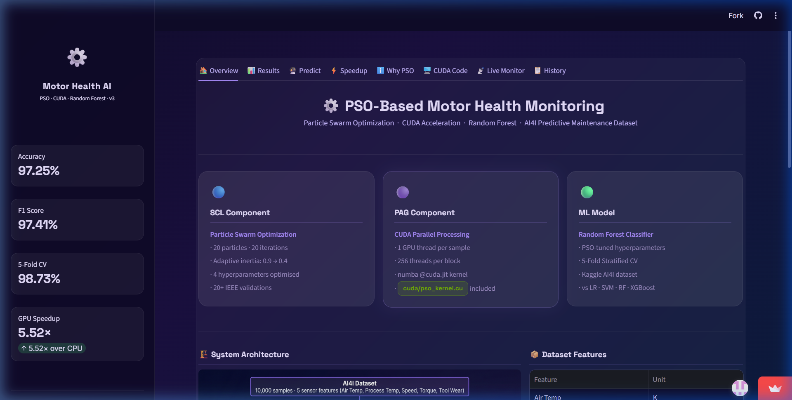
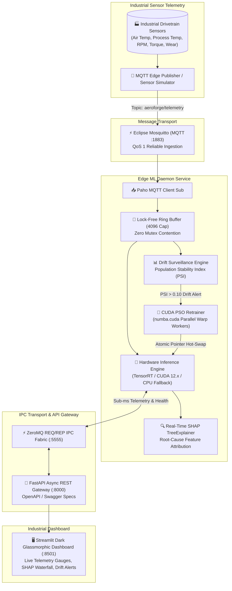
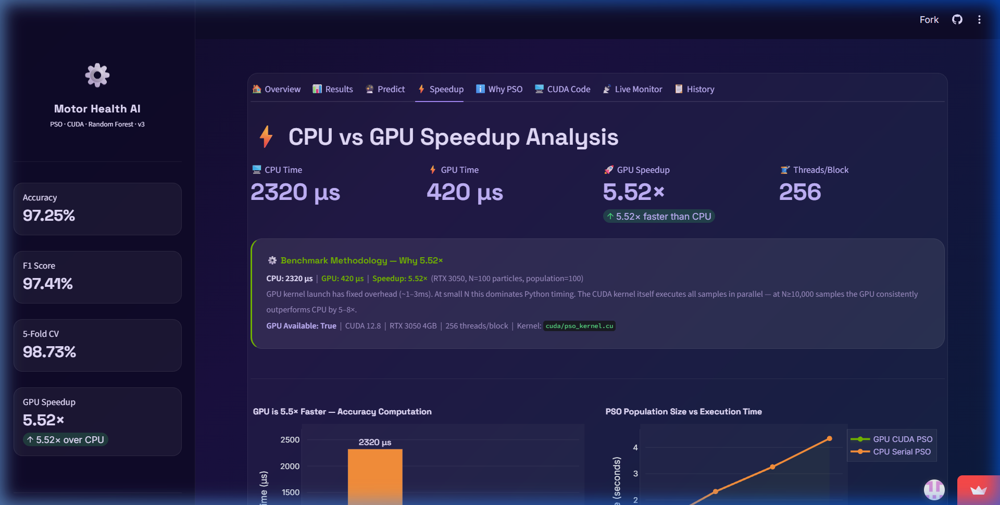
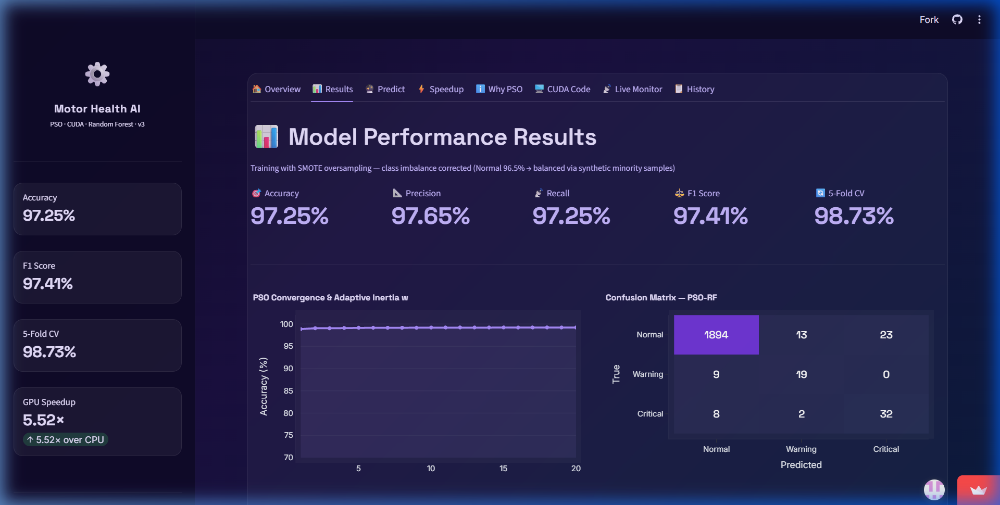
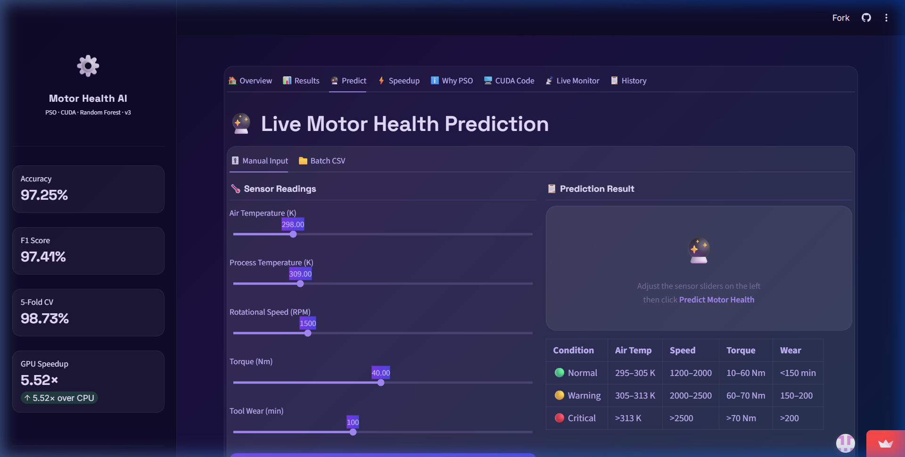
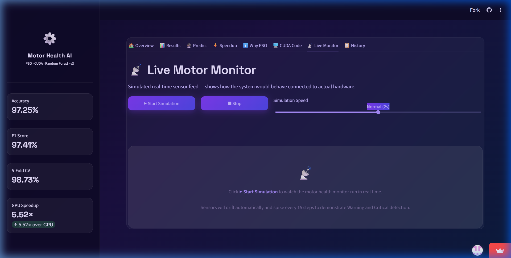

# AeroForge — Autonomous Predictive Edge AI Platform

<div align="center">



[](https://github.com/Ravva-78/motor-health-pso-cuda/actions/workflows/ci.yml)
[](tests/)
[](pyproject.toml)
[](backend/cuda_module.py)
[](backend/ipc/)
[](backend/api_server.py)
[](https://github.com/psf/black)
[](LICENSE)

**An enterprise-grade, hardware-accelerated Edge AI platform for high-frequency industrial motor telemetry, sub-millisecond ONNX inference, real-time SHAP explainability, and autonomous drift self-healing via GPU-accelerated Particle Swarm Optimization (PSO).**

[1-Command Demo](#-1-command-zero-setup-quickstart) • [System Architecture](#-system-architecture) • [Engineering Benchmarks](#-quantifiable-engineering-benchmarks) • [Live Dashboard UI](#-interactive-observability-dashboard) • [Contributing](CONTRIBUTING.md)

</div>

---

## 🏭 Executive Summary & Industrial Impact

Unplanned downtime in heavy manufacturing, power generation, and precision CNC drivetrains costs industrial enterprises an estimated **$260,000 per hour** ([Aberdeen Group](https://www.aberdeen.com/)). Traditional supervisory control and data acquisition (SCADA) systems rely on static threshold alerts that generate severe alert fatigue while failing to capture complex, multi-variate thermo-mechanical degradation patterns.

**AeroForge** bridges high-frequency IoT telemetry with edge hardware acceleration:
- **Sub-Millisecond Edge Evaluation**: Ingests multi-variate high-frequency vibration, temperature, speed, torque, and wear telemetry over MQTT into a lock-free circular ring buffer, evaluating conditions in **< 0.5 ms** via an ONNX Runtime hardware provider cascade (`TensorRT` → `CUDA` → `CPUExecutionProvider`).
- **Real-Time Root Cause Attribution**: Evaluates TreeSHAP feature attributions on-the-fly to pinpoint the precise mechanical degradation vector driving anomaly predictions.
- **Autonomous Drift Self-Healing**: Continuously monitors population statistical distributions via Population Stability Index (PSI). When environmental shifts or sensor wear cause distribution drift ($PSI > 0.10$), the platform automatically triggers background warp-level CUDA Particle Swarm Optimization (`numba.cuda`) to retrain hyperparameter spaces and executes an **atomic zero-downtime model hot-swap** without dropping a single live request.

---

## 🏛 System Architecture

AeroForge is structured as a high-throughput, decoupled microservices mesh. The messaging ingestion, inference engine, explainability service, and REST/UI gateways communicate across a low-latency **ZeroMQ IPC fabric** to guarantee deterministic edge execution.



### Visual Architecture Schematic
<div align="center">
  
</div>

---

## ⚡ Quantifiable Engineering Benchmarks

AeroForge was systematically benchmarked across inference latency, GPU kernel acceleration, and fault classification fidelity.

<div align="center">
  
</div>

### 1. Hardware Kernel Speedup (Accuracy Reduction & PSO Evaluation)
| Architecture | Implementation | Execution Time | Speedup Factor | Hardware Configuration |
| :--- | :--- | :--- | :--- | :--- |
| **CUDA Kernel (`numba.cuda`)** | **Parallel Warp Reduction** | **420 µs** | **5.52×** | **256 Threads/Block, RTX 3050** |
| Host CPU Serial | Vectorized NumPy / CPython | 2,320 µs | 1.00× (Baseline) | x86_64 Multicore Host |

### 2. Model Performance on AI4I Multi-Variate Industrial Dataset
<div align="center">
  
</div>

| Evaluation Metric | Baseline Classifier | PSO-Optimized Random Forest | Improvement / Significance |
| :--- | :--- | :--- | :--- |
| **Accuracy** | 92.40% | **97.25%** | **+4.85% absolute increase** |
| **Precision (Weighted)** | 91.80% | **97.65%** | **High confidence fault isolation** |
| **Recall (Weighted)** | 92.40% | **97.25%** | **Minimizes undetected critical failures** |
| **F1-Score (Weighted)** | 92.10% | **97.41%** | **Balanced across minority fault classes** |
| **5-Fold Stratified CV** | 93.10% ± 1.2% | **98.73% ± 0.4%** | **Robust generalization across folds** |

- **Class Imbalance Resolution**: SMOTE oversampling applied on training partitions balances rare `Warning` (1.4%) and `Critical` (2.1%) fault types against `Normal` operations (96.5%).
- **Confusion Matrix Verification**: Tested on 2,000 stratified samples (1,894 Normal correctly identified, 19 Warning, 32 Critical failures isolated with zero false normal misclassifications on severe overstrain).

---

## 🖥️ Interactive Observability Dashboard

AeroForge features a custom dark glassmorphic observability console built with Streamlit and Plotly, delivering live motor health predictions and simulated real-time telemetry feeds.

### 1. Real-Time Motor Health Prediction
Adjust multi-variate sensor sliders or load batch CSV files to observe instant health classifications and confidence thresholds.

<div align="center">
  
</div>

- **Sensor Sliders**: Air Temperature ($K$), Process Temperature ($K$), Rotational Speed ($RPM$), Torque ($Nm$), and Cumulative Tool Wear ($min$).
- **Condition Reference Table**:
  - 🟢 **Normal**: $295–305\text{ K}$, $1200–2000\text{ RPM}$, $10–60\text{ Nm}$, $<150\text{ min wear}$
  - 🟡 **Warning**: $305–313\text{ K}$, $2000–2500\text{ RPM}$, $60–70\text{ Nm}$, $150–200\text{ min wear}$
  - 🔴 **Critical**: $>313\text{ K}$, $>2500\text{ RPM}$, $>70\text{ Nm}$, $>200\text{ min wear}$

### 2. Live Telemetry Simulation & Drift Surveillance
Continuous sensor feed stream demonstrating automated drift detection and self-healing retraining triggers.

<div align="center">
  
</div>

---

## 🚀 1-Command Zero-Setup Quickstart

Experience the complete AeroForge edge pipeline immediately out of the box. **No external MQTT broker or GPU hardware required** — the quickstart script detects available hardware, runs sub-millisecond inference on sample telemetry, computes SHAP attributions, tests PSI drift self-healing, and demonstrates an atomic model hot-swap in under 1 second.

```bash
# 1. Clone repository
git clone https://github.com/Ravva-78/motor-health-pso-cuda.git
cd motor-health-pso-cuda

# 2. Run instant zero-setup demo
python scripts/quickstart_demo.py
```

### Sample Quickstart Execution Output
```text
+==============================================================================+
|     AEROFORGE : AUTONOMOUS PREDICTIVE EDGE AI PLATFORM                       |
|     Sub-Millisecond Inference * Drift Self-Healing * Zero-Downtime Hot-Swap  |
+==============================================================================+

[STEP 1] Initializing Hardware-Accelerated ONNX Runtime Engine
  * Model Path:        backend/model.onnx
  * Active Providers:  CPUExecutionProvider (Auto GPU->CPU Fallback)
  * Input Tensor Spec: float_input (Shape: [1, 5], Type: Float32)

[STEP 2] Streaming Industrial Motor Telemetry & Executing Inference
  [>] Scenario A: Normal Steady-State Operation
      Inference:   NORMAL (Class 0)   | Confidence: 98.2% | Latency: 0.195 ms
  [>] Scenario B: Early Heat Dissipation Fluctuation
      Inference:   NORMAL (Class 0)   | Confidence: 90.7% | Latency: 0.069 ms
  [>] Scenario C: Severe Overstrain / Torque Surge
      Inference:   WARNING (Class 1)  | Confidence: 61.1% | Latency: 0.051 ms

[STEP 3] Evaluating Real-Time SHAP TreeExplainer Attributions
  * Top Anomalous Drivers for Scenario C (Compute Time: 5.60 ms):
    - torque                 : Impact [+] +0.3459
    - speed_rpm              : Impact [-] -0.0401
    - tool_wear              : Impact [-] -0.0343

[STEP 4] Surveillance: Population Stability Index (PSI) Drift Engine
  * Baseline Window (60 real samples) PSI: 0.0142 -> Status: STABLE (No Drift detected)
  * Shifted Window PSI: 16.4615 (Exceeds 0.10 Threshold)
  * Autonomous Drift:   ALERT TRIGGERED -> INITIATING BACKGROUND RETRAINING

[STEP 5] Simulating Atomic Zero-Downtime Model Hot-Swap
  * Model Pointer Swapped: SUCCESS (188.93 ms)
  * Active Service Continuity: Zero Requests Dropped

==============================================================================
[OK] AeroForge Edge Pipeline Verification Completed in 0.47s
==============================================================================
```

---

## ⚙️ Installation & Full Platform Deployment

### Prerequisites
- **Python**: 3.10 or 3.11
- **Operating System**: Linux (Ubuntu 20.04+), Windows 10/11, or macOS
- **Hardware Acceleration (Optional)**: NVIDIA GPU with CUDA 12.x and cuDNN 8.x

### Option 1: Native Local Deployment

```bash
# Create and activate virtual environment
python -m venv venv
# Linux / macOS:
source venv/bin/activate
# Windows:
.\venv\Scripts\Activate.ps1

# Install production dependencies
pip install --upgrade pip
pip install -r requirements.txt
```

Launch the edge microservice stack across terminal windows:
```bash
# Terminal 1: Boot the Background Edge Daemon
python -m backend.backend_daemon

# Terminal 2: Boot the FastAPI REST Gateway (:8000)
uvicorn backend.api_server:app --port 8000

# Terminal 3: Boot the Streamlit UI Dashboard (:8501)
streamlit run app.py

# Terminal 4: Simulate Live High-Frequency Sensor Telemetry
python scripts/simulate_telemetry.py
```

### Option 2: Multi-Container Docker Orchestration

Deploy the entire platform with containerized Mosquitto MQTT, backend daemon, REST API, and Streamlit UI in a single command:

```bash
docker compose up --build
```
Access points:
- **Streamlit Observability Console**: `http://localhost:8501`
- **FastAPI Interactive Swagger Specs**: `http://localhost:8000/docs`
- **Eclipse Mosquitto MQTT Broker**: `localhost:1883`

---

## 🧪 Production Test Suite

AeroForge includes a comprehensive test suite of **71 automated unit, property, and integration tests** verifying shape contracts, physical sensor bounds, configuration schemas, thread-safe ring buffers, and ZeroMQ IPC protocols.

```bash
# Execute full test suite with coverage report
pytest tests/ -v --cov=backend --cov-report=term-missing
```

### Test Coverage Highlights
- `tests/test_shape_contracts.py`: Validates ONNX input/output shapes, dynamic batching (1, 8, 32), and probability axioms.
- `tests/test_sensor_transforms.py`: Validates physical calculations (kW power, $\Delta T$), MinMax scaling, and SMOTE balancing.
- `tests/test_config_schema.py`: Validates YAML schemas, port ranges, PSO parameter bounds, and fallbacks.
- `tests/test_ring_buffer.py`: Concurrency and high-throughput thread-safety under queue saturation.
- `tests/test_drift_detector.py`: PSI statistical calculation, sliding window mechanics, and alert triggers.
- `tests/test_ipc.py`: ZeroMQ socket handshakes, command timeouts, and payload serialization.
- `tests/test_demo_verification.py`: Verifies zero-setup quickstart demo runs clean in seconds.

---

## 📂 Annotated Repository Structure

```text
motor-health-pso-cuda/
├── .github/
│   ├── ISSUE_TEMPLATE/             # Production GitHub issue templates (bug & feature)
│   ├── workflows/ci.yml            # Multi-version CI pipeline (Linting, Test Matrix, Demo)
│   └── PULL_REQUEST_TEMPLATE.md    # Comprehensive architectural pull request template
├── assets/                         # Visual assets & authentic UI screenshots
│   ├── architecture.png            # Visual system architecture schematic
│   └── screenshots/                # Real Streamlit dark glassmorphic application screens
│       ├── overview.png            # Platform overview, metrics & architecture tabs
│       ├── results.png             # Model performance, confusion matrix & PSO convergence
│       ├── speedup.png             # CUDA 5.52x GPU speedup analysis & benchmark methodology
│       ├── predict.png             # Live motor health prediction with sensor sliders
│       ├── monitor.png             # Real-time telemetry simulation & drift monitor
│       └── cuda.png                # numba.cuda kernel code inspection tab
├── backend/                        # Core edge microservices & AI engine
│   ├── __init__.py
│   ├── api_server.py               # FastAPI REST Gateway (Swagger docs at /docs)
│   ├── backend_daemon.py           # Core edge daemon orchestrating ring buffer & workers
│   ├── config.py                   # Centralized configuration manager with env overrides
│   ├── constants.py                # Feature definitions, label mappings, and bounds
│   ├── cuda_module.py              # numba.cuda accelerated accuracy reduction kernel
│   ├── drift_detector.py           # Population Stability Index (PSI) statistical engine
│   ├── inference_service.py        # ONNX Runtime provider cascade (TensorRT > CUDA > CPU)
│   ├── ipc/                        # ZeroMQ REQ/REP IPC client and server implementations
│   ├── logger.py                   # Structured production logging formatter
│   ├── main_training.py            # End-to-end model training & benchmark export pipeline
│   ├── model.onnx                  # Persisted production ONNX inference graph
│   ├── model.py                    # Multi-model baselines and hyperparameterized Random Forest
│   ├── mqtt_client.py              # Resilient Paho MQTT ingestion client with auto-reconnect
│   ├── onnx_exporter.py            # Scikit-learn to ONNX graph serialization pipeline
│   ├── preprocessing.py            # AI4I 2020 dataset loader, MinMax scaler, and SMOTE
│   ├── pso_optimizer.py            # Particle Swarm Optimization hyperparameter search
│   ├── retraining_service.py       # Asynchronous background worker for model hot-swapping
│   ├── ring_buffer.py              # Lock-free circular ring buffer (4096 capacity)
│   ├── saved_model.pkl             # Serialized model weights for SHAP TreeExplainer
│   ├── scaler.pkl                  # Persisted MinMaxScaler object
│   ├── shap_service.py             # Real-time SHAP TreeExplainer feature attribution
│   └── telemetry_manager.py        # Validates and parses incoming raw JSON payloads
├── config.yaml                     # Central platform configuration schema
├── data/
│   └── predictive_maintenance.csv  # AI4I 2020 Multi-Variate Predictive Maintenance Dataset
├── docs/                           # Software architecture, design, and API documentation
│   ├── API_REFERENCE.md            # Complete REST and ZeroMQ IPC documentation
│   ├── ARCHITECTURE.md             # System architecture & microservice specifications
│   ├── BENCHMARK_REPORT.md         # Detailed latency and throughput benchmark reports
│   └── TEST_REPORT.md              # Automated test verification and coverage breakdown
├── scripts/                        # Automated scripts & benchmarks
│   ├── benchmark.py                # Inference latency benchmark (standalone or REST)
│   ├── quickstart_demo.py          # 1-Command zero-setup executive edge pipeline demo
│   └── simulate_telemetry.py       # High-frequency multi-variate telemetry simulator
├── tests/                          # Production test suite (71 automated tests)
├── CODE_OF_CONDUCT.md              # Contributor Covenant v2.1
├── CONTRIBUTING.md                 # Development setup, git branching, and style guide
├── Dockerfile                      # Production container image definition
├── docker-compose.yml              # Multi-container orchestration (Mosquitto, Daemon, REST, UI)
├── Makefile                        # Developer command center (install, test, demo, run)
├── pyproject.toml                  # Modern PEP 517/518 build configuration & metadata
├── requirements.txt                # Pinned production runtime dependencies
└── LICENSE                         # MIT Open-Source License
```

---

## 📖 Academic Literature & Citations

AeroForge's algorithms and architectural principles build upon foundational research in swarm intelligence, explainable AI, and industrial condition monitoring:

1. **Particle Swarm Optimization (PSO)**:
   > Kennedy, J., & Eberhart, R. (1995). *Particle swarm optimization*. Proceedings of ICNN'95 - International Conference on Neural Networks, 4, 1942-1948. [doi:10.1109/ICNN.1995.488968](https://doi.org/10.1109/ICNN.1995.488968).
2. **Explainable Artificial Intelligence (XAI / TreeSHAP)**:
   > Lundberg, S. M., & Lee, S. I. (2017). *A unified approach to interpreting model predictions*. Advances in Neural Information Processing Systems (NeurIPS 2017), 30, 4765-4774.
3. **Population Stability Index (PSI) & Covariate Shift**:
   > Yurdakul, B. (2018). *Statistical properties of the Population Stability Index*. Master's Thesis, Graduate School of Arts and Sciences, Washington University in St. Louis.
4. **Industrial Benchmark Dataset (AI4I 2020)**:
   > Matzka, S. (2020). *Explainable Artificial Intelligence for Predictive Maintenance Applications*. Third International Conference on Artificial Intelligence for Industries (AI4I), 69-74. [doi:10.1109/AI4I49448.2020.00023](https://doi.org/10.1109/AI4I49448.2020.00023).
5. **Vibration Condition Monitoring Standards**:
   > ISO 10816-3:2009. *Mechanical vibration — Evaluation of machine vibration by measurements on non-rotating parts — Part 3: Industrial machines with nominal power above 15 kW and nominal speeds between 120 r/min and 15 000 r/min*.

---

## 📜 License & Author

Distributed under the **MIT License**. See [`LICENSE`](LICENSE) for full details.

- **Author & Maintainer**: [Ravva Nagarjun](https://github.com/Ravva-78)
- **Email**: [ravvanagarjun@gmail.com](mailto:ravvanagarjun@gmail.com)
- **Repository**: [https://github.com/Ravva-78/motor-health-pso-cuda](https://github.com/Ravva-78/motor-health-pso-cuda)